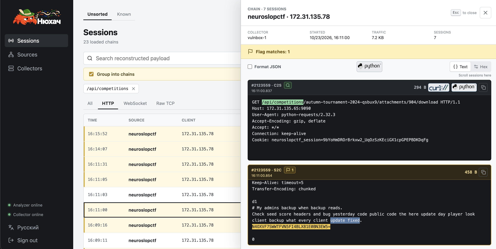
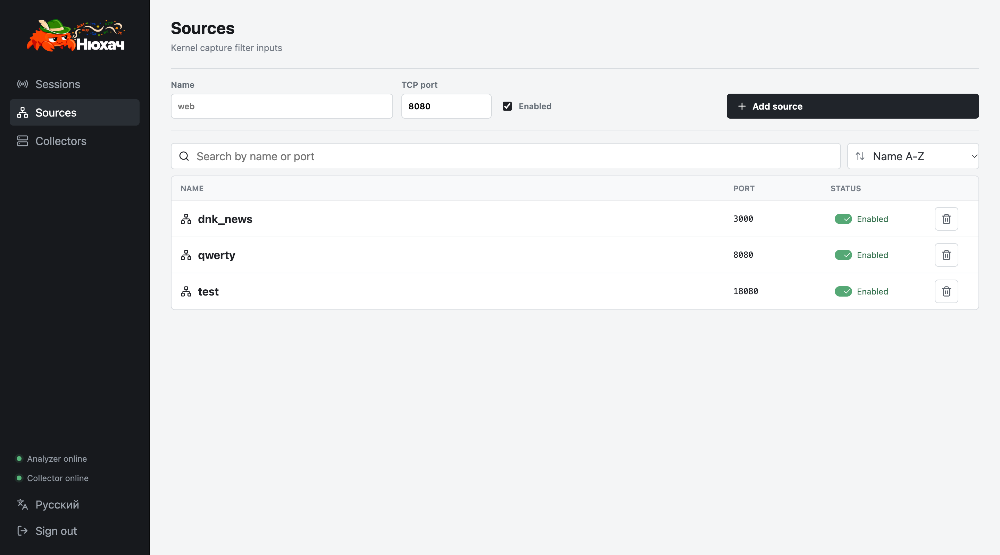

# Нюхач

`newhatch` - легковесный анализатор траффика для Attack/Defence CTF соревнований



## Установка

Создайте `.env` и установите креды для входа:

```bash
cp .env.example .env
```

```py
NEWHATCH_USERNAME=admin
NEWHATCH_PASSWORD=admin123
```

## Быстрый старт (Всё-в-одном)

Для управления с клавиатуры в терминале можно установить [newhatchctl](newhatchctl-src/README.md):

```bash
curl -fsSL https://raw.githubusercontent.com/Thunboo/newhatch/main/install/unix.sh | bash
newhatchctl
```

Чтобы напрямую запустить сервис на Vulnbox:

```bash
# (!!!) Сначала настройте CAPTURE_INTERFACE, FLAG_REGEX и креды в .env
docker compose up -d --build analyzer frontend
```

Откройте `http://localhost:8080`, войдите и добавьте сервисы для мониторинга на вкладке Источники:



## Раздельный деплой

По дефолту `ANALYZER=local` запускает сбор и анализ трафика на одном хосте в контейнере `analyzer`. Для раздельного деплоя (снижает нагрузку на vulnbox) используйте следующую конфигурацию:

### Receiver (НЕ Vulnbox)

Подготовка `.env`:
```python
ANALYZER=remote
LISTEN_CONNSTR=0.0.0.0:39090
# Опционально - IPs or FQDNs. Пустое поле = принимаем трафик любого коллектора
ALLOWED_COLLECTORS=VULNBOX_IP_OR_FQDN
```

Запустите анализатор и фронт на ресивере:
```bash
docker compose up -d --build analyzer frontend
```

### Vulnbox

На вулнбоксе делаем такой конфиг, а затем запускаем только легковесный коллектор:
```python
CAPTURE_INTERFACE=eth0
COLLECTOR_ID=vulnbox-1 # Опционально
ANALYZER_CONNSTR=ANALYZER_IP_OR_FQDN:39090
```

```bash
docker compose --profile collector up -d --build collector
```

### ИБэшная часть

- TCP порт `39090` (или иной указанный) между коллектором и анализатором должны быть открыты;
- `ANALYZER_CONNSTR` принимает записи вида `IP:port` или `FQDN:port`. аналогично для `LISTEN_CONNSTR`;
- Не пустой `ALLOWED_COLLECTORS` принимает IP и FQDN, указанные через запятую; 
- DNS резолвится при старте анализатора - для перерезолва нужен рестарт;
- Маршрут Коллектор-Анализатор незашифрован (Backlog task), юзать только в доверенных или шифрованных VPN сетках;
- Источники, указанные во фронте - добавляются на коллектор автоматически.

## Полезные проверки

```bash
docker compose ps
docker compose logs -f analyzer
curl http://analyzer-host:8080/api/health
```

### Проверки захвата флагов

Фикстура зафиксирована в [`test/flag_test/README.md`](test/flag_test/README.md)

## Информация о проекте

В [PROJECT.md](PROJECT.md) есть краткое описание, текущая реализация и архитектурные ограничения. Более подробные описания в [`docs/`](docs/).

### Основное меню - Сессии и Функции:

- **Просмотр сессий** - клик по сессии / цепи сетей раскрывает просмотрщик.
- **Группировка в цепочки** - включение группировки связанных событий (kill-chains). В просмотрщике - пролистывание сессий производится ползунком или скроллом по правой части окна.
- **Фильтрация** - Добавление тектовых фильтров через панель поиска. Совпадение с фильтром отмечает текст зеленый в окне просмотрщика.

В окне C2S есть кнопки экспорта cURL/Python запроса; в режиме цепей - есть кнопка кспорта python скрипта на повторение всех запросов цепочки. 

Запустите `python3 replay.py` на автоподставленный айпи или `python3 replay.py <IP/FQDN>` для смены ip при сохранении порта. Доп. инфо - [Python replay](docs/python-replay.md).
