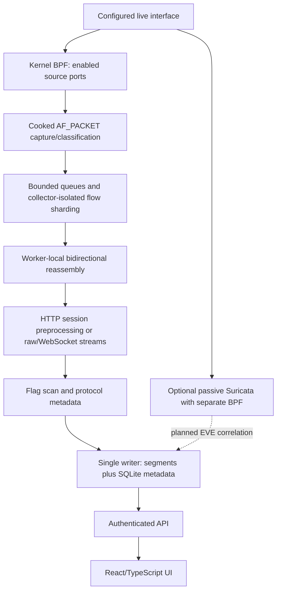

# Architecture

The analyzer owns TCP reconstruction and stored sessions. Suricata captures
independently as optional enrichment; neither its JSON/log output nor its
availability controls Rust ingest.



## Capture and Sources

A Source is id/name/TCP port/enabled state. Enabled ports generate classic BPF
installed with SO_ATTACH_FILTER before userspace. Source changes rebuild the
socket/filter; no enabled Sources pauses capture.

The Linux path uses a nonblocking AF_PACKET/SOCK_DGRAM socket bound to
CAPTURE_INTERFACE, registered with Tokio, and recvmsg with kernel receive timestamps.
Cooked mode strips link headers, giving the same L3 layout for Ethernet,
WireGuard/TUN, loopback and Docker bridges.
Current parsing accepts IPv4/TCP and IPv6/TCP without extension headers.
IP fragments and extension-header walking are deferred. Cooked mode needs no
link-layer VLAN parser, but VLAN deployment behavior needs target-host validation.
PACKET_MMAP/RX rings are not implemented; measure the socket path before adopting them.

## Concurrency and reassembly

Normalize client/server endpoints so both directions hash to the same worker.
Remote flows also include CollectorId: equal endpoint tuples from different
collectors must not merge. Each worker has a local HashMap, bounded packet channel
and configurable active-flow limit. Avoid global hot-path locks and unbounded
queues; saturation drops new packets and exposes counters.

Each direction tracks TCP sequence order and bounded out-of-order ranges.
Trim retransmitted overlap; conflicting pending overlaps suppress further
assembly. The pending set is limited to 256 ranges and MAX_STREAM_BYTES bytes.
Sequence comparisons handle wraparound. FIN is effective only after its preceding
bytes have been assembled; missing bytes can still arrive before idle expiry.

Raw TCP/WebSocket streams retain bounded directional byte vectors and finalize
on RST, both-direction FIN or idle timeout. Timed-out, truncated, gapped or
not-fully-closed connection records are incomplete. HTTP session preprocessing,
its inactivity timer and asymmetric retention limits are specified in
[Atomic HTTP Sessions](http-sessions.md). Expiry uses analyzer monotonic time;
capture timestamps remain traffic chronology, including for remote collectors.

Raw TCP/WebSocket incremental byte scans use a 4 KiB overlap as an early hint;
finalization computes exact FLAG_REGEX matches over canonical decoded text.
HTTP flags use each emitted atomic session's canonical C2S/S2C text.
[Readable-v1](session-filtering-v2.md#canonical-payload-text) defines decoding,
display coordinates and startup migration of retained flag metadata.
Store contains_flag, flag_direction
(none/c2s/s2c/both) and flag_count. Never scan packets independently to decide
session flags.

HTTP/1.x metadata includes method, host, path, status and content type.
HTTP Upgrade/101 detects websocket, but frame decoding is not implemented.
Unrecognized protocols retain raw_tcp visibility. Recognized HTTP with ambiguous
association is suppressed according to [Atomic HTTP Sessions](http-sessions.md),
rather than emitted as an unsplit or one-sided HTTP record.

## Remote Collector Boundary

Local mode captures inside analyzer (ANALYZER=local). In split mode:

```text
collector AF_PACKET/BPF -> ClassifiedPacket -> length-prefixed protobuf
-> analyzer ingress -> CollectorId + FlowKey -> flow worker
```

crates/protocol owns shared types and the versioned transport.
Collectors are diskless: capture/classification, an in-memory Source snapshot,
bounded queue, reconnect/backoff and counters. Analyzer owns every heavy concern:
reassembly, flag/protocol analysis, storage, API/auth and chain queries.
After handshake and each Source revision, analyzer pushes all active Sources;
collector rebuilds BPF.

Collector connects to ANALYZER_CONNSTR; remote analyzer listens on LISTEN_CONNSTR.
IP/FQDN endpoints include ports; literal IPv6 is bracketed. Collector resolves DNS
again on reconnect. Nonempty ALLOWED_COLLECTORS permits exact IPs and addresses
resolved from FQDNs at analyzer startup; empty admits any host. DNS allowlist
changes require analyzer restart. Transport has no application authentication
or encryption yet; PSK hardening is deferred.

Collector QUEUE_CAPACITY defaults to 8192 classified packets. A full queue drops
and counts new packets rather than growing memory.
Deployment commands/configuration are in [README](../README.md).

## Timestamps

Store Unix microseconds using kernel capture time, falling back to system time
when unavailable. started_at/ended_at are minimum/maximum observed packet times,
including out-of-order arrival. first_payload_c2s_at/first_payload_s2c_at are
minimum capture times of observed nonempty directional packets, including
retransmissions; empty directions and legacy data remain NULL.
For HTTP, timestamps describe each atomic session rather than the entire TCP
connection. This adds no per-packet persistence.

## Storage, API and UI

A bounded completed-session channel feeds one storage writer.
[Storage](storage.md) defines append/sync/SQLite ordering, retention and record format.
Writer failure must be visible. API disconnects, slow readers, absent frontend
and absent Suricata must not impose control on packet workers.

Axum provides Sources, session metadata, directional payloads, flag ranges,
collectors and bounded search. Session pages cap at 200 and payload search at
2,000 metadata-prefiltered candidates per request. Metadata supports source,
protocol, flag presence, endpoint IP/port and started_after.
[Authentication](authentication.md) defines the independent nginx/analyzer checks;
[filtering](session-filtering-v2.md) defines payload lists and limits.
[Chain queries](session-chains.md#api-and-work-limits) run on demand in bounded
blocking readers, outside packet workers.
Source/owner-scoped [known attack rules](session-buckets.md) match ordered HTTP
events inside full chains in the same bounded readers. They store definitions,
not payloads or a global session category, and require no ingest reclassification queue.
User-visible behavior belongs to [MVP UX](mvp.md).

## Suricata

Compose runs a passive sensor on the configured interface, writing data/suricata.
It cannot block traffic. SURICATA_BPF_FILTER is static and independent from UI
Sources; operators align it manually. EVE ingestion, alert details and session
correlation are not implemented; suricata_alerts remains a reserved zero field.

Potential correlation choices are Community ID or normalized 5-tuple plus time;
no choice is fixed. Store enrichment as metadata, not payload records.
Inline drop is a separate deployment decision because false positives can break
checkers/SLA. The analyzer must function without Suricata.

Fixed scope is in [decisions](agent-decisions.md); unresolved policies are in
[open questions](../.agents/memory/open-questions.md).
